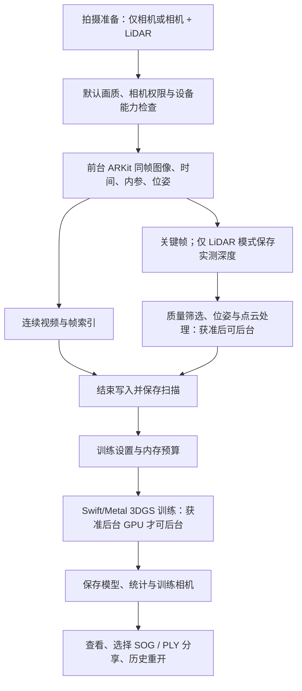
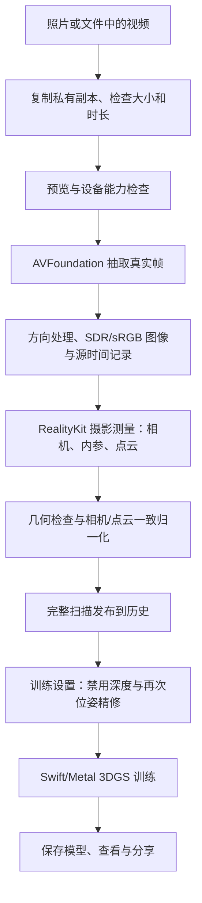

# App 功能、处理流程与 iPhone 真机测试指南

本文介绍当前源码 **Yun‘s Scanner 1.0（build 2）** 的实际功能、两种输入方式、数据处理 pipeline，以及安装到自己 iPhone 的方法。工程名称仍为 `arkit-3dgs-scanner`，早期版本显示名为 ARKit 3DGS Scanner。更新日期：2026-10-23。研发与验收的持续记录以 [README](../README.md) 为准。

此前 App 已编译为 iPhone 真机目标，并在模拟器验证界面、选片、既有模型导入、训练和查看；带新图标的 build 1 Release 签名版本已实际安装到 iPhone 18 Pro / iOS 27.2 并成功启动。build 2 新增拍摄前的两种重建方式、条件后台运行和 SOG/PLY 分享选择，build 2 已完成 Release 真机归档、模拟器构建、签名校验，并更新安装到同一实体 iPhone，确认成功启动。**实体 iPhone 的完整视频重建、ARKit/LiDAR 采集、后台执行和性能尚未验收。** 当前及旧归档位置见第 6.4 节。不能把归档或安装成功理解为重建流程测试成功。

**当前个人账号版本不能持续后台运行 GPU 重建。** 本轮 Xcode 实际拒绝为当前 Personal Team 签发 Background GPU Access 能力，因此默认版本保留可用的个人签名：拍摄结束后的 CPU 位姿/点云阶段可申请后台；已有视频摄影测量需保持前台，3DGS 切后台会尝试保存检查点并暂停。本次 iPhone 18 Pro / iOS 27.2 的当前运行配置也返回 `gpuSupported=false`。完整后台 GPU 路径已有条件支持，但还需要具备相应签名授权的 Team、实际支持的设备和本次任务的系统批准，不能仅凭更换账号保证可用。

## 1. App 做什么

App 将多视角图像重建成可旋转、缩放查看的 **3D Gaussian Splatting（3DGS，高斯泼溅）模型**。它主要保存场景的三维外观，不等同于可直接用于 CAD 的封闭三角网格。

当前有三种入口，其中前两种用于在手机内生成模型：

| 入口 | 输入与处理位置 | 得到什么 |
| --- | --- | --- |
| **开始扫描** | 拍摄前选择仅相机或相机 + LiDAR；实时 ARKit 采集，在手机训练 | 带真实采集位姿的扫描数据、点云及训练后的 3DGS 模型 |
| **使用已有视频** | 从照片或文件选择视频；抽帧、摄影测量、训练均在手机执行 | 视频来源的扫描数据及 3DGS 模型；没有已知米制尺度 |
| **扫描记录 → 导入 3DGS 模型** | 导入本项目约定的模型 ZIP | 查看已有模型；不是重新处理视频，也不代表本机完成了训练 |

手机视频流程不需要启动 Mac 网页服务，也不会把视频上传到重建服务器。如果所选视频只存在于 iCloud，系统选片器仍可能先下载原文件；文件到达设备后才开始本地处理。

## 2. 完整功能模块

下表介绍已实现的功能。涉及相机、LiDAR、摄影测量和手机 GPU 的项目，仍需要在实际设备逐项验证。

| 模块 | 当前功能 | 条件或边界 |
| --- | --- | --- |
| 首页与语言 | “开始扫描”“使用已有视频”“扫描记录”、设备能力标识、操作指南；仅简体中文和 English | 默认简体中文，旧繁体设置自动迁移；用户文件名和自定义内容保持原样 |
| 实时扫描 | 同一个 ARFrame 获取图像、时间、内参、相机位姿、跟踪状态及可用深度；连续录像、自动关键帧、实时点云和覆盖/运动提示 | 要求 ARKit 世界跟踪；深度取决于设备；首选后置广角约 1920 长边、30 fps，记录实际格式 |
| 拍摄准备与采集设置 | 准备页明确选择“仅相机”或“相机 + LiDAR”，记住选择；保留一种默认采集画质；相机内仍可配置适用的几何和曝光选项 | 无 LiDAR 设备禁用该模式；主要参数在扫描前设置，默认优先约 1080p / 30 fps，记录实际格式 |
| 停止、复查与续扫 | 等待视频和数据收尾，筛选图像，按配置处理位姿/几何；查看点云和轨迹，续扫、丢弃、导出或进入训练 | “续扫”针对仍保留的当前采集会话；世界图重定位另有能力，不等于任意旧扫描都能直接续拍 |
| 已有视频导入 | 照片/文件单选，复制私有副本，显示文件名、时长、大小、SDR 封面和原视频播放；抽帧、估计相机与点云，进入训练 | iOS 26+ 且系统摄影测量能力检测通过；后台计算还需满足第 3.4 节条件 |
| 扫描历史与数据管理 | 封面、图像/点数、模式和训练状态；点云预览、拍摄图像与相机轨迹回放；质量与选帧信息；单笔/批量删除 | 图像轨迹回放不是连续原片播放器；正在训练的扫描不可直接删除；删除扫描会移除其数据 |
| 训练数据优化 | 对适用的 ARKit 扫描优化位姿、重融合几何，另存结果，保留原始照片与采集记录 | 普通视频不开放 ARKit 优化入口，不把估计相机冒充传感器测量 |
| 平面图与尺度辅助 | 从点云尝试提取平面图，显示已有墙/房间等信息、房间命名；提供 JSON/SVG/DXF；ARKit 扫描可进行两点距离、已知长度校正及独立长度验证 | 取决于输入和提取结果，不保证测量精度；RoomPlan 代码默认未启用，USDZ 也不是默认必有输出；普通视频隐藏米制测量入口 |
| 端侧 3DGS 训练 | 快速预览、标准、高质量；分辨率和迭代设置，适用的 PPISP、Mip 和位姿微调选项；实时预览、进度、耗时、高斯数和内存 | 需要支持的 Metal GPU；实际配置受图片数量和内存预算影响，先用快速预览验证闭环 |
| 暂停与恢复 | 暂停/继续、保存进度、停止并保留或删除本次训练、提前保存模型；有原始输入的本地模型可加强或重新训练 | 恢复依赖完整检查点与可用资源；仅导入模型 ZIP 时没有原始照片，不能继续训练 |
| 模型查看 | 单指旋转、双指平移、捏合缩放、重设视角、退出后重开；有 PPISP 数据时可切换校正效果 | iOS 27 真机优先尝试 RealityKit 高斯后端；不适用、资源失败或需 PPISP 校正时用 Metal，记录实际后端 |
| 导入与分享 | 分享模型时明确选择 SOG 或 PLY，生成对应 ZIP；扫描/训练数据另行导出；模型包先校验再加入历史；Files 可访问 App 文档目录 | 每个模型 ZIP 只含所选格式与必要记录；没有保存的格式禁用，不假装转换；导入需符合项目契约 |
| 后台与资源保护 | 拍摄结束后的 CPU 位姿/点云处理申请持续后台任务；视频摄影测量和 3DGS 另申请后台 GPU；显示实际授权状态，保留内存、温度、电量保护 | 实际获准后才能后台计算；未获准或任务结束时安全停止/暂停。视频准备需要重试，训练可从完整检查点继续；强制结束 App 不会继续运行 |

## 3. 处理流程 pipeline

### 3.1 方式一：直接扫描，再在手机训练

“开始扫描”先打开拍摄准备页，选择“仅相机”或“相机 + LiDAR”，再点击“进入相机”。两种方式共用一种默认采集画质；实时采集同时保存视频与相机信息，并非先录一段普通视频、再从零估计所有相机。



1. RGB、内参、位姿关联同一个 ARFrame；选择相机 + LiDAR 且设备支持时使用同步 `sceneDepth`，不是原始激光回波。仅相机模式关闭 LiDAR 深度和场景网格，依靠图像与真实 ARKit 位姿重建点云。
2. 连续视频保留实际帧间时间；关键帧用于训练。缺深度、丢帧或写入失败有记录，不补造数据。
3. 停止后先在前台等待最后图像、视频和相机会话收尾，再进行 CPU 位姿/点云处理；页面显示实际获准后台后才切换其他 App。原始输入与优化结果分开保存。
4. 用户在训练页启动 3DGS；完成保存后才能作为模型查看和分享。

ARKit 数据具有米制坐标语义，但实际尺度和测量误差仍需真机验证。没有 LiDAR 的相机模式不会获得真实 LiDAR 深度。

### 3.2 方式二：已有视频，完全在 iPhone 内重建



| 阶段 | 当前行为 |
| --- | --- |
| 输入 | 系统可解码的视频，优先 MOV/MP4；不超过 180 秒、2,000,000,000 字节；复制原片，不覆盖照片/文件中的源视频 |
| 抽帧 | 按真实源时间选择帧，约 0.5 秒间隔，并受总数限制；最多 `min(200, 系统图片上限)` 张，长边最多 1600，不放大图片；至少需要 8 张有效图片 |
| 颜色与方向 | 应用一次视频方向变换；HDR 经原生 `forceSDR` 和色彩管理输出 sRGB 8-bit JPEG；记录原始颜色和处理策略 |
| 摄影测量 | 获取真实估计的相机内参、位姿和稀疏点云；缺少有效结果则失败，不生成假相机 |
| 几何准备 | 校验坐标解释、投影与尺寸，相机平移和点云一起归一化；写入 `metricScale: false` |
| 数据发布 | 图片、位姿、点云及来源清单全部成功后才进入扫描库，随后打开训练页 |
| 训练 | 普通视频关闭深度初始化/深度损失和再次位姿精修；PPISP 默认关闭，可由用户启用；使用与扫描路径共用的 Swift/Metal 训练器 |

**普通视频没有 LiDAR 深度，也没有已知物理尺度。** 结果可用于外观查看，但不能把归一化单位直接解释为米。抽帧和相机估计成功只是“准备好训练数据”，还需要启动训练并完成模型保存。

准备从前台启动；实际获得后台 GPU 授权后可以切换其他 App。未获准时切后台、取消、离开页面、系统任务到期、严重过热或内存警告会停止准备；重新开始时重新执行准备阶段，用户原片保留。训练阶段另有检查点恢复机制。

### 3.3 两种输入共用的训练与查看

训练读取图片、相机内参/位姿及初始化点云，选择有效训练视角，再执行高斯初始化、可微渲染、误差计算、参数优化和增密，最后保存模型与实际运行记录。

“快速预览”（Quick）的基础配置为长边 960、4,000 次迭代、最多 300,000 个高斯、SH 2 阶；手机自动迭代还会根据训练图片数量调整，内存预算可能限制实际规模。配置上限不是保证产出的数量，也不是手机耗时承诺。

模型加载后选择可用的 RealityKit 或 Metal 后端；后端选择与原因保存在 `viewer-backend.txt`。支持的 iOS 27 真机仍需核对实际选择，不能因为工程编译了原生 API 就认定它已在手机正常显示。

### 3.4 切换其他 App 时怎样继续计算

计算从 App 内主动启动，等待页面显示“已获准后台处理，可以切换到其他 App。”后再切换。只有“正在申请”或“请保持前台”时，尚不能持续后台运行；每个处理阶段都要以它自己的状态为准。

| 阶段 | 后台条件 | 未获准或中断后的行为 |
| --- | --- | --- |
| 拍摄视频、实时 ARKit 跟踪 | 必须前台使用相机 | 切后台暂停采集；不能把后台计算能力当作后台录像能力 |
| 拍摄结束后的位姿和点云处理 | 相机/最后图像收尾完成，CPU 持续后台任务实际获准 | 停止处理并保存可保留的扫描数据；回前台按界面提示重试 |
| 已有视频抽帧和摄影测量 | 设备开放后台 GPU、签名授权有效、持续后台任务实际获准 | 安全停止准备，保留原片，回前台重新准备；尚无抽帧/摄影测量断点续算 |
| 3DGS 训练与模型保存 | 后台 GPU 能力、签名授权和实际任务授权均满足 | 尝试保存检查点并暂停；回前台继续完整检查点，未发布模型不标记完成 |

系统取消或任务到期时，即使 App 已回到前台，也会停止对应任务。后台运行仍受系统资源调度约束；**从多任务界面强制结束 App 后，不会继续重建**。CPU 后台获准不表示后续 GPU 阶段也已经获准。

### 3.5 Mac 流程与手机流程的关系

项目还保留独立研究流程：**Mac 上传/收件箱 → FFmpeg 抽帧 → Apple 摄影测量 → 共享 Swift/Metal 训练器 → SuperSplat 浏览器查看 → 模型 ZIP → iPhone 导入查看**。

这条流程可以用于对照和排查，但不是手机“使用已有视频”的依赖。Mac 网页当前拒绝直接输入 HDR；已有 HDR 实验使用了另行记录的 SDR 转换。手机入口使用原生 SDR 抽帧，不能混淆两种入口的输入限制。

## 4. 数据保存与导出结果

扫描保存在 App 的 `Documents/scans/`；视频准备阶段的私有草稿位于 `Application Support/video-imports/`，成功后才发布为 `scan_video_*`。

| 文件或目录 | 用途 |
| --- | --- |
| `color.mov`、`frames.jsonl`、`capture-meta.json` | ARKit 连续采集的视频、帧索引及配置/状态记录 |
| `capture-processing.json` | 拍摄后的处理状态、阶段、进度和模式；与连续录像是否完整分开记录，录像完成不代表点云/位姿处理成功 |
| `images/`、`poses.jsonl`、`points.ply` | 共用训练输入：图像、相机记录和初始化点云；此处的 PLY 不是高斯模型 |
| `depth/` | 采集路径实际获得的深度和置信度；普通视频不伪造此目录的数据 |
| 原视频副本、`video-source.json`、`video-frames.json`、`video-import.json` | 视频来源、SHA-256、源时间、颜色/方向处理、摄影测量与任意尺度声明 |
| `sparse/0/` | 导出给外部研究工具的 COLMAP 相机、位姿与点云 |
| `gaussian-training/model/` | `gaussians.sog`、标准 GS `gaussians.ply`、`gaussians.json`、`experiment.json`、`training-report.json`、`training-poses.jsonl`，以及按情况生成的预览、PPISP 与视频来源文件 |
| 检查点与 `imported-model.json` | 前者用于恢复本地训练；后者标记导入的既有模型，不伪造成手机采集记录 |

App 的 `Documents/background-processing.json` 另记录本机后台能力与任务事件，用于真机检查请求、实际授权、后台进度及结束原因；它不是模型训练结果，也不能仅凭一次 granted 事件认定整个流程完成。

分享时区分三类产物：

- **扫描/训练数据 ZIP**：照片、相机、点云及可用的深度/录像等，用于研究与外部训练。原始视频和照片可能使文件较大。
- **3DGS 模型 ZIP**：点击分享后选择 SOG 或 PLY，分别生成 `*-3dgs-sog.zip` 或 `*-3dgs-ply.zip`，每包只含所选模型及相机、尺度来源、实验等记录。SOG 是压缩模型，PLY 是标准高斯参数格式；均不是扫描初始化点云。只有 SOG 的导入模型不提供不存在的原始 PLY，反之亦然。历史页“导入 3DGS 模型”接收符合契约的 ZIP；包中没有原始训练照片，不能直接加强或重新训练。
- **App 归档/安装包**：Xcode 生成的 `.xcarchive` 或经签名导出的 `.ipa`，用于分发程序，与前两种数据 ZIP 无关。

模型导入检查 ZIP 路径、CRC、大小、数量、模型格式与相机记录，成功后再发布。当前限制为压缩包最多 512 MiB、解压内容最多 768 MiB、最多 64 个条目。具体接口见 [模型查看](模型查看.md)。

## 5. 当前验证到哪一步

| 范围 | 已验证 | 还需要真机确认 |
| --- | --- | --- |
| 语言与界面 | 基线 670 条中文资源转换和 25 项语言检查通过；本轮新增文案继续提供简体/英文；已有切换及视频页 UI 回归通过 | 新拍摄准备、格式选择和后台状态的真机交互 |
| 构建与安装 | Debug iPhoneOS/Simulator 构建、带新图标的 Release 签名归档通过；已在 iPhone 18 Pro / iOS 27.2 安装并启动，包内仅含简体中文与英文 | 真实设备上的各项功能与重建流程 |
| 已有视频准备 | 原始 HDR 视频用共享原生代码在 Mac 得到 102 张图像、102 个相机与 7,974 个点；模拟器照片/文件选片和预览通过 | iPhone 摄影测量能力、完整视频到模型、手机内存与中断行为 |
| 3DGS 训练 | GPU 回归、真实视频 Mac 重建，以及从已准备输入出发的模拟器训练通过 | 手机实际耗时、峰值内存、温度、暂停恢复及结果质量 |
| 模型导入与查看 | 真实模型在模拟器导入、Metal 显示、旋转缩放、重置和重开通过 | 真机 RealityKit/Metal 显示、颜色、性能与回退 |
| 实时采集、平面图与尺度 | 编译、编解码和数据契约回归通过；相关功能已有实现 | 实际传感器同步、跟踪、几何/尺度精度、平面图结果与异常路径 |
| 两种拍摄方式与模型分享 | 7 项采集模式 CPU 检查、SOG/PLY 实际 ZIP 和重新导入回归通过 | 两种模式完整采集、系统分享及真机查看 |
| 持续后台计算 | CPU/GPU 请求、实际授权门禁和停止保护已实现；当前 Personal Team 的后台 GPU 签名被 Xcode 拒绝 | CPU 实际授权与后台进度；获得所需 GPU 签名和设备能力后再验收视频/训练持续后台 |

模拟器不支持本次视频摄影测量。模型在 Mac 或模拟器成功，不代表实体 iPhone 的全流程已经成功；Mac 和模拟器耗时也不能作为手机性能指标。

## 6. 把 App 安装到自己的 iPhone

### 6.1 先确认设备与构建条件

| 条件 | 当前要求 |
| --- | --- |
| 工程最低系统 | 用户当前将 App target 设置为 iOS 27.0；最初未签名归档的旧配置为 iOS 17.0 |
| 已有视频完整重建 | iOS 26+，且 `PhotogrammetrySession.isSupported` 为真；以 App 实际能力提示为准 |
| ARKit/LiDAR 采集 | 世界跟踪支持独立检查；LiDAR 深度、完整几何功能取决于硬件 |
| 端侧训练 | 通过 App 的 Metal GPU 能力和内存检查 |
| 持续后台 GPU | 默认个人签名不含该权限；需要可签发 Background GPU Access 的 Team、支持的设备及任务实际授权，三者缺一不可 |
| RealityKit 原生高斯显示 | iOS 27+ 真机分支；其他情况使用适用的 Metal 路径 |
| 当前开发环境 | Xcode 27.1，iOS 27.1 SDK；需要 Xcode 能识别并支持手机系统 |
| 当前签名状态 | 已使用用户自己的 Team 完成开发签名，在开启开发者模式的 iPhone 18 Pro / iOS 27.2 安装并启动 |

本工程申请了 `com.apple.developer.kernel.increased-memory-limit`。它只在部分设备上有作用，不保证额外内存一定可用。免费 Personal Team 能否为当前配置签名，以登录后的实际 provisioning 结果为准；如果 Xcode 报 capability/profile 不匹配，应根据具体报错处理，不能将“去掉该能力”当成已经验证过的等价训练配置。[Apple 内存能力说明](https://developer.apple.com/documentation/bundleresources/entitlements/com.apple.developer.kernel.increased-memory-limit)

本轮 Xcode 已明确提示当前 Personal Team 不支持 Background GPU Access，默认工程因此使用普通 entitlement 配置，保留原有内存能力，不能把该构建称为完整后台 GPU 版。`Config/BackgroundGPU.entitlements` 单独保留包含后台 GPU 权限的配置，供有相应签名授权的 Team 构建；构建时以 `CODE_SIGN_ENTITLEMENTS=Config/BackgroundGPU.entitlements` 选择。只有成功签名、运行时设备支持且实际任务获准后才能测试后台 GPU，不能靠把键写入文件绕过系统授权。

### 6.2 推荐：Xcode 直接安装到自己的手机

这是首次单台 iPhone 测试的最短路径，不需要先制作 IPA，也不需要上架 App Store。

1. **连接并信任设备。** 用 USB 连接 Mac 和 iPhone，解锁手机；出现提示时点击“信任此电脑”。
2. **打开工程。** 在 Finder 打开 `project/arkit-3dgs-scanner.xcodeproj`；也可以在项目根目录运行：

   ```sh
   open arkit-3dgs-scanner.xcodeproj
   ```

3. **登录自己的 Apple 账号。** 在 Xcode → Settings → Apple Accounts 添加 Apple Account；较旧 Xcode 可能显示为 Accounts。登录和双重认证由本人完成。
4. **设置签名。** 在工程导航中选择蓝色工程图标 → TARGETS 下的 `arkit-3dgs-scanner` → Signing & Capabilities。保留 Automatically manage signing，在 Team 中选择自己的团队或 Personal Team。当前用户已设置 `com.liyunshan.arkit3dgsscanner`，继续测试时保持该 Bundle Identifier 与 Team；在另一位开发者的环境才按需要改成其可用的唯一标识。改变标识可能把后续构建安装成另一个 App。
5. **完成配对和开发者模式。** 当前 Xcode 可从运行目标菜单 Manage Devices… 或 Xcode → Open Developer Tool → Device Hub 管理设备；旧版入口可能是 Window → Devices and Simulators。选中实体 iPhone，完成配对提示。在手机“设置 → 隐私与安全性 → 开发者模式”开启，按提示重启并再次确认。若没有该选项，先通过 Xcode 发起设备配对。
6. **选择正确的 scheme 和手机。** 顶部 scheme 选 `arkit-3dgs-scanner`，运行目标选你连接的实体 iPhone，不能选模拟器或仅用于构建的 Generic iOS Device。主 scheme 的 Run 使用 Release，适合首轮训练测试；只有调试源码时才选 `arkit-3dgs-scanner-Debug`。
7. **运行安装。** 点击 Run（▶）或按 `⌘R`。Xcode 将构建、签名、安装并启动 App。签名、配对或系统兼容错误必须先解决；仅看到 Build Succeeded 并不等于安装成功。
8. **确认手机启动。** 手机上应出现 Yun‘s Scanner 首页，包含“开始扫描”和“使用已有视频”。实际扫描时允许相机权限。若系统另外要求信任开发者，按实际提示在“设置 → 通用 → VPN 与设备管理”完成；没有提示不必额外操作。安装成功后可停止 Xcode 调试，从手机主屏幕重新打开，确认脱离 Mac 后仍能运行。

流程依据：[Apple 运行与签名说明](https://developer.apple.com/documentation/xcode/running-your-app-on-simulated-or-physical-devices)、[设备配对](https://developer.apple.com/documentation/xcode/pairing-your-devices-with-your-mac)、[开启开发者模式](https://developer.apple.com/documentation/xcode/enabling-developer-mode-on-a-device)。

免费 Personal Team 可用于自己的设备测试；其 provisioning profile 通常只有 **7 天**有效期，到期需要用相同账号和 Bundle ID 再构建安装，不要先卸载 App，以免删除尚未导出的扫描数据。免费账号还有设备和 App 数量限制；此方式不是长期分发渠道。[Apple 免费账号说明](https://developer.apple.com/help/account/basics/about-your-developer-account)

### 6.3 如果需要导出可以安装的 IPA

| 方式 | 适合场景 | 需要什么 |
| --- | --- | --- |
| Xcode 直接 Run | 当前自己的一台 iPhone | 自己的 Apple 账号、可用签名配置、设备配对与开发者模式 |
| 注册设备分发 / Ad Hoc | 给指定的几台测试手机安装 | 相应开发者会员、证书、App ID，以及包含设备 UDID 的 provisioning profile |
| TestFlight | 后续多人远程测试、通过邀请下载 | Apple Developer Program、App Store Connect 记录、签名上传构建及测试配置；外部测试涉及 Beta App Review |

要获得签名 IPA，应先完成 Team 和 Bundle ID 配置，再执行 Product → Archive。归档完成后，在 Organizer 选择 Distribute App，按账号和用途选择当前 Xcode 提供的注册设备测试方式（例如 Debugging）或对应 Ad Hoc 方式，选择包含目标手机的签名配置再导出。菜单可能随 Xcode 版本变化，以实际可选方式为准。

导出的有效 IPA 可通过 Device Hub 中实体设备的 Apps → “＋”安装，也可使用 Apple Configurator。**将 `.app`、未签名归档或随意压缩出的 `.ipa` AirDrop 到 iPhone，不会完成 App 安装。** 自己首次测试优先用上一节的 Xcode Run。

TestFlight 是另一条需要准备的分发渠道；本项目当前没有上传 TestFlight，也没有可供点击下载的邀请链接。配置完成后，测试者通过 TestFlight 接受邀请安装；单次构建最多测试 90 天。

官方参考：[注册设备分发](https://developer.apple.com/documentation/xcode/distributing-your-app-to-registered-devices)、[Ad Hoc 描述文件](https://developer.apple.com/help/account/provisioning-profiles/create-an-ad-hoc-provisioning-profile/)、[Device Hub 安装 App](https://developer.apple.com/documentation/xcode/managing-apps-on-devices)、[TestFlight](https://developer.apple.com/testflight/)。

### 6.4 版本归档及复现命令

**当前已安装的 build 2**：`.build/iphone-release/20261023-1.0-b2-reconstruction/YunsScanner-1.0-b2.xcarchive`。这是已校验签名的 Release 归档，已更新安装到本人的 iPhone 18 Pro / iOS 27.2，并成功启动。版本 1.0（2），Bundle ID `com.liyunshan.arkit3dgsscanner`，最低 iOS 27.0，签名描述文件有效期至 2026-10-30 11:04:43（北京时间）。使用默认个人签名权限，不含后台 GPU entitlement；后台边界见本文开头。构建、安装和能力检测记录在 `.build/feature-reconstruction-20261023/validation.json`，真实拍摄重建与后台 CPU 进度仍待验收。

**上一已安装的新图标 build 1**：`.build/iphone-release/20261023-1.0-b1-new-icon-signed/YunsScanner-1.0-b1.xcarchive`。它是已经通过签名校验的 Release 归档，Bundle ID 为 `com.liyunshan.arkit3dgsscanner`，最低 iOS 27.0；其中的 App 已直接安装到本人的 iPhone 并启动。当次描述文件有效期至 2026-10-30 11:04:43（北京时间），到期需要重新签名安装。此签名针对描述文件中的设备，不代表可以安装到任意手机；尚未发布 TestFlight。本轮源码已升为 1.0（build 2），其新归档和安装结果以 README 最新记录为准，旧 build 1 不包含本轮新增功能。

**此前保留的旧版本**输出目录为项目下 `.build/iphone-release/20261023-1.0-b1/`。其中 `ARKit3DGSScanner-1.0-b1-unsigned.xcarchive` 是 **Release / iPhoneOS / arm64 / 未签名**归档；构建日志为 `archive.log`，交付清单为 `build-manifest.json`。已核对版本 1.0（1）、最低 iOS 17.0、简体/英文两份语言资源，确认没有签名及描述文件。压缩交付件为 `.build/iphone-release/ARKit3DGSScanner-1.0-b1-unsigned.zip`，保留归档、日志、指南、构建清单、LICENSE、NOTICE 与原始授权文件；同目录 `.zip.sha256` 用于核对摘要。这个旧包未更新为本次图标和用户的新配置。

这个归档用于保留本次构建版本，**不能直接安装到手机，也不是签名完成的 IPA**。签名账号就绪后，首次自用安装按 6.2 节从当前工程构建；需要分发时按 6.3 节重新进行签名归档。

以下命令只用于复现无签名 Release 归档。运行前在 `.build/iphone-release/` 下选一个尚不存在的新输出目录，避免覆盖已有版本；示例使用 `local-unsigned`：

```sh
xcodebuild \
  -project arkit-3dgs-scanner.xcodeproj \
  -scheme arkit-3dgs-scanner \
  -configuration Release \
  -sdk iphoneos \
  -destination 'generic/platform=iOS' \
  -derivedDataPath .build/DerivedData-ios-release \
  -archivePath .build/iphone-release/local-unsigned/ARKit3DGSScanner.xcarchive \
  CODE_SIGNING_ALLOWED=NO CODE_SIGNING_REQUIRED=NO archive
```

签名安装不能沿用这里的 `CODE_SIGNING_ALLOWED=NO`。源码及分发授权原文见 [LICENSE](../LICENSE)、[NOTICE](../NOTICE)；本版本保留非商业科研原型定位。

## 7. 安装后的第一轮实机测试

本轮重点是拍摄前的两种方式、分阶段后台行为及 SOG/PLY 分享；已有视频仍需回归。先完成每种方式的正常流程，再单独测试后台和中断，避免把采集问题与系统调度问题混在一起。拍摄保持前台，训练先用“快速预览”。

### 7.1 手机相机拍摄测试

1. 打开 App → **开始扫描**，先在拍摄准备页选择 **仅相机**；确认只使用默认画质，再点击 **进入相机**并允许相机权限。
2. 对静态有纹理的桌面物体或房间一角，缓慢移动拍摄 30–60 秒，让相邻视角有充分重叠。拍摄期间保持前台，观察跟踪和运动提示。
3. 停止拍摄后等待最后图像、录像和相机会话收尾；检查位姿和点云处理进度。若页面明确显示已获准后台，可以按第 7.3 节单独测试切换其他 App。
4. 处理完成后核对点云、图像和轨迹，再进入训练，记录实际配置和结果。仅相机方式不应生成伪造的 LiDAR 深度。
5. 支持 LiDAR 的手机再拍一次同类场景：返回准备页选择 **相机 + LiDAR**，确认选择被记住，检查实际深度、图像与位姿对应。无 LiDAR 设备应显示禁用说明。
6. 每种方式都等到模型保存完成，再旋转、缩放、重置和退出重开；分别选择 **SOG**、**PLY** 分享到“文件”，检查文件名区分格式，并通过历史页重新导入两种 ZIP 查看。

“仅相机”仍保存 ARKit 相机位姿；它与下面的普通视频摄影测量路径不同。测得的质量、耗时和深度对齐结果分别记录，不能用某一种成功替代另一种验收。

### 7.2 已有视频回归

1. 将 Mac 下载目录中的 `IMG_0568.MOV` 用 AirDrop、iCloud Drive 或其他文件传输方式放入手机“照片”或“文件”。传的是**视频输入**，不是 App 安装包；确保已完整下载到手机。若手机原本就有同一视频，直接选用即可。
2. 打开 App → **使用已有视频** → **从照片选择视频**或**从文件选择视频**。
3. 核对文件名、时长、大小和画面；当前原片约 50.73 秒，为 HDR 视频。封面先按 SDR 显示，点击播放查看原片，记录真机是否存在曝光/颜色异常。
4. 查看设备能力提示。若显示不支持视频重建且按钮禁用，先记录手机型号、iOS 版本和完整提示；这表示当前设备/系统不满足摄影测量能力，反复选片不能绕过。
5. 点击 **在 iPhone 上准备重建**。观察抽帧、相机/点云估计和保存数据阶段；当前个人签名版本需保持前台。将来具备后台 GPU 权限的构建只有实际获准后才能切后台。完成后进入 **3DGS 训练**页。
6. 选择 **快速预览**，首轮保留视频默认设置（PPISP 关闭，深度和再次位姿精修禁用），开始训练。记录实际图像数、迭代数、高斯数、耗时、内存和任何暂停原因。
7. 等待模型保存结束，再旋转、平移、缩放、重设视角；与原视频比较主要结构、方向和颜色。流程完成不等于画质完全合格，模糊、缺口和漂浮点也应记录。
8. 回到扫描记录，重新打开模型；再结束 App 并从主屏幕重开，确认模型仍能查看。点击分享模型，分别选择 SOG 和 PLY 保存 ZIP，保留本次结果和实验信息；重新导入仍应保持普通视频的任意尺度声明。

### 7.3 后台与中断测试

- **拍摄后 CPU 处理**：正常停止拍摄，等待收尾和实际后台授权提示；切换其他 App 一段时间，再返回核对进度与结果。未获准时应提示并安全停止，不能将录像完整状态当作点云处理完成。
- **当前个人签名的视频准备**：切后台应安全停止，原片仍可重新选择/准备；不应显示后台 GPU 正在持续运行。
- **当前个人签名的 3DGS**：训练中切后台应尝试保存检查点并暂停；返回后继续，检查迭代恢复、原始数据和已有模型完整性。
- **具备 GPU 权限的后续构建**：只有运行时支持且显示实际获准后，分别在摄影测量和训练阶段切换其他 App，核对真实后台进度。更换 Team 或 entitlement 文件本身不算验收。
- **系统取消和任务到期**：不论当前前台还是后台，都应停止对应任务；视频重新准备、训练按完整检查点恢复。强制结束 App 后不应继续计算，也不能承诺保住尚未写出的迭代。

后台证据保留 `Documents/background-processing.json`；直接拍摄另保留扫描内 `capture-processing.json`，训练另保留状态和检查点。系统可能因资源情况拒绝或结束任务，这种情况记录为受限/中断，不能标成持续后台成功。

拍摄后处理被中断而当前采集页仍打开时，可以按“重新处理”再跑；App 重开后，有实测深度的扫描可从历史“优化训练数据”重新处理位姿与融合。仅相机扫描的历史优化不会补做 RGB 点云，必要时从已保存视频重新导入。这个恢复边界与 3DGS 检查点续训不同。

### 7.4 每次测试保留的最小记录

| 类别 | 记录内容 |
| --- | --- |
| 环境 | iPhone 型号、iOS、App 版本/build、安装方式、可用存储、电量/供电状态 |
| 输入 | 仅相机/相机 + LiDAR 模式，或视频文件名、时长、分辨率、HDR/SDR；需要严格对比时保留 SHA-256 |
| 准备 | 抽取和有效图像数、摄影测量是否成功、准备耗时、错误原文 |
| 训练 | 实际配置、迭代数、高斯数、耗时、报告内存、暂停/恢复/温度表现 |
| 后台 | CPU/GPU 阶段、实际能力与签名版本、授权提示、切换时间、后台进度、取消/停止原因；保留诊断文件 |
| 查看 | 实际后端、朝向/颜色/结构问题、手势和重新打开结果 |
| 产物 | 分别保存 SOG、PLY 模型 ZIP 和重新导入结果；保留实验/训练报告；采集测试另保留原始扫描包 |

遇到失败先保留错误提示和已有数据，不靠删除 App 反复重装排查。只有对应步骤在真实 iPhone 完成后，才把它更新为真机已验收。

## 8. 开发与模块文档入口

| 领域 | 主要源码 | 详细说明 |
| --- | --- | --- |
| 首页与语言 | `ContentView.swift`、`Capture/Localization.swift` | 本文第 1、2 节 |
| 采集、存储与导出 | `Capture/CaptureController.swift`、`Capture/CaptureStreamRecorder.swift`、`Capture/ExportManager.swift` | [采集与存储](采集与存储.md) |
| 视频处理 | `VideoImport/VideoImportView.swift`、`VideoImport/VideoImportCoordinator.swift`、`VideoImport/VideoFrameExtractor.swift`、`VideoImport/VideoPhotogrammetry.swift` | [数据处理](数据处理.md) |
| 历史、测量、平面图 | `History/ScanHistoryView.swift`、`History/SceneMeasurementView.swift`、`Capture/FloorPlanCapture.swift` | [采集与存储](采集与存储.md)、[数据处理](数据处理.md) |
| 训练与检查点 | `Training/GaussianTrainingSession.swift`、`Training/GaussianTrainer.swift`、`Training/TrainingWorkspace.swift`、`Training/UI/GaussianTrainingView.swift` | [高斯重建](高斯重建.md) |
| 后台任务与诊断 | `Background/ContinuedProcessingLease.swift`、`Training/UI/TrainingCenter.swift`、`VideoImport/VideoImportCoordinator.swift` | 本文第 3.4、7.3 节；[高斯重建](高斯重建.md) |
| 模型导入与查看 | `History/GaussianModelImport.swift`、`Training/GaussianModelViewer.swift`、`Training/GaussianRealityKitViewer.swift` | [模型查看](模型查看.md) |

源码路径相对 `arkit-3dgs-scanner/`。新增或修改功能时同步更新对应模块文档，实测日志留在 `.build/` 或实验数据目录。

## 采集 Beta：首版操作

2026-10-28 的 build 5 排查记录（当前已安装 build 7），首页为翻转图标，1080p / 4K 切换保持等宽。真机和模拟器编译通过，真机布局检查通过；拍摄按钮就绪测试仍失败，尚未录制成功。App 收到的相机帧近乎全黑，ARKit 停在初始化；结束 App 后系统相机也未恢复，用户反馈重启手机后仍黑屏。需先让系统相机恢复正常取景，再进入 Beta 对准光照充足的纹理场景，验证拍摄、停止、预览和 ZIP。此次相机修复不能标为验收通过；诊断日志保留在 `.build/beta-camera-fix-20261028/`。

已有视频真机结果（2026-10-28，build 4）：使用既有 IMG_0568 SDR 视频，真机从 Files 导入、重新抽帧/估计位姿、预览、Visualization、ZIP 保存和退出后重开全部通过。得到 102 张图像、102 个位姿、489 个稀疏点，ZIP 约 92.7 MB；文件完整性、原视频摘要及源时间对应已核对。修复了新结果预览中的系统路径别名识别问题。实时拍摄、4K、LiDAR 和距离精度仍待专门采集验收。

2026-10-28 已将 Release 1.0（build 3）更新安装到 iPhone 18 Pro / iOS 27.2，启动及首页显示通过，原有扫描记录仍可见。请按下面步骤继续实际采集验收；本次安装不代表 4K、LiDAR 同步、距离精度及真机 ZIP 已通过。当前个人签名有效期至北京时间 2026-10-30 11:04:43，之后需重新签名安装。

1. 点重建首页右上角翻转图标，页面翻转进入橙色 Beta；右上角回转按钮返回重建模式。Beta 和重建场景分别保存。
2. “开始拍摄”直接打开相机。左侧文字选择 1080p / 4K，右侧切换 LiDAR；开拍后锁定选择。不支持的能力禁用。橙色胶囊显示时长与累计路程，右上角显示距起点最远距离。
3. 停止后等待录像收尾，进入场景预览。根据是否已采集 LiDAR，选择是否随包导出。进入 Visualization 检查轨迹与点云，点击“保存场景 ZIP”，再“导出到文件 / 分享”。
4. “查看场景 / 使用已有视频”进入独立 Beta 场景库，可重开场景，也可从照片或文件选择视频。已有视频仍需在支持摄影测量的真机上估计位姿；结果只有相对尺度，没有 LiDAR。非 MOV 原片原样保留，另以 passthrough 转封装 MOV，抽帧与位姿时间对应此 MOV，不进行 ProRes 转码。

当前模拟器能验证入口、界面、已有结果预览及 ZIP 保存；不能拍摄或运行手机摄影测量。模拟器中的 `scan_ui_validation_real_video` 是此前 Mac 已处理的真实视频，仅用于界面和数据包验证。手机回来后重点验证相机权限、1080p/4K 实际格式、LiDAR 开关、停止录像、运动提示、后台中断以及导出包的图像/位姿/深度对应关系。当前实际开发环境为 Xcode 27.1、iPhone 18 Pro 模拟器 / iOS 27.0，未完成 iOS 17 兼容工作。

### 场景管理更新（build 7）

1. 进入 Beta 拍摄页后可允许“使用 App 期间”定位；画面显示地址或经纬度及精度。拒绝定位仍能拍摄。新录制场景取得位置后，在详情页点击位置即可打开地图；旧视频缺少位置时显示“未记录”。
2. 点开场景，点击上方名称行或铅笔，输入名称后保存。名称用于首页、场景库和导出文件夹，拍摄时间另行保留。
3. 查看场景页右上角切换卡片和列表；列表左侧为名称、右侧为缩略图，选择会被记住。
4. 点击“选择”，可逐项勾选或“全选”；点击“批量保存”生成一个 ZIP，每个场景一个以名称命名的子目录。同名目录自动编号；保存完成后点“批量 ZIP 已保存”即可打开分享/存储面板。默认包含各场景已有 LiDAR，可关闭该选项。
5. 删除单个场景使用详情页底部“删除场景”；多选后可“删除”。确认后删除场景和原始采集文件，此前导出的 ZIP 保留。

定位是场景位置标记，不是 GPS 轨迹或测绘坐标校准。地图测试坐标只能验证界面；实际定位授权、室内外精度及与实时拍摄同时工作仍需真机检查。此前系统相机取景异常的排查结果独立保留，场景管理更新不代表已修复实时拍摄。

本轮 build 7 已在手机原位更新，Device Hub 实测卡片/列表、全选 3 个场景及批量保存成功，已有数据保留。取回 ZIP 的中文目录名、CRC 和每场景图片/位姿数量核对通过。模拟器完整回归验证了改名持久化、地图入口、取消删除及单个/批量删除测试副本。用户后续说明系统相机本机画面为所有镜头发灰模糊；此前电脑黑色预览不能代替这一观察。本轮未重新验收实时相机或真实 GPS 定位。
